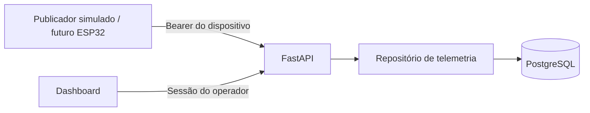

# Implementação do Movement para a categoria INTERFACE

## Decisões

- API própria em Python/FastAPI; ThingSpeak/TalkBack sai do fluxo final.
- Backend em VPS paga; PostgreSQL gerenciado em produção, sujeito à contratação.
- PostgreSQL nativo no Windows e Python venv no desenvolvimento; sem Docker local.
- Web React e mobile Expo reaproveitados.
- GoF: Strategy para política de publicação e Command para controle.
- Otimização matemática do intervalo de publicação, independente da leitura local.

## Marcos e critérios de conclusão

| Marco | Estado | Critério |
|---|---|---|
| 1. API e telemetria | Implementado; consultar registro de validação | Publicação autenticada → PostgreSQL → dashboard |
| 2. Firmware | Pendente | Medição do circuito chega à API por HTTPS |
| 3. Comandos | Pendente | Envio, confirmação, expiração e reentrega segura |
| 4. Regras uniformes | Pendente | Firmware, backend e interfaces concordam nos cenários de referência |
| 5. Otimização e Strategy | Pendente | Formulação, solução, comparação e aplicação do intervalo |
| 6. Mobile | Pendente | App consulta a mesma API e mostra estado confirmado |
| 7. Circuito e física | Pendente | Circuito lógico, tabelas, dimensionamento e ensaios |
| 8. Arquitetura | Parcial | C4/UML finais e dois padrões GoF demonstrados |
| 9. Nuvem e CD | Pendente | VPS, banco gerenciado, HTTPS, backup e pipeline de deploy |
| 10. Defesa e congelamento | Pendente | Evidências, ensaio individual e preservação após avaliação |

O marco 1 não significa conformidade completa com o edital.

## Pendências externas

- Confirmar equipe inscrita (3 a 5 da mesma turma/semestre); documentação antiga lista 13 colaboradores.
- Conferir inscrição e tema, pois o prazo de 11/09/2026 já passou.
- Ler o Regulamento Geral, ainda não fornecido.
- Confirmar ferramenta de simulação: o roteiro cita Proteus/Logisim, não Wokwi.
- Definir provedor e acesso da VPS e serviço de PostgreSQL gerenciado.
- Confirmar a data individual entre 09 e 13/11/2026.

Após a avaliação individual, o edital proíbe alterar o projeto: identificar a versão
avaliada e impedir deploys/OTA que a modifiquem antes do evento de 28/11/2026.

## Arquitetura do marco 1

O backend armazena horário da medição e recebimento, vínculo do dispositivo,
estado efetivo do A/C e modo manual. Um identificador único impede duplicação.
Leituras antigas são identificadas mesmo quando a API continua acessível.

O primeiro marco usa um operador com acesso aos ambientes cadastrados. Controle
remoto, eventos persistidos e permissões por ambiente ainda não estão implementados.
O mobile e o firmware original ainda usam ThingSpeak; a migração é incremental.

## Verificação reproduzível

Siga `backend/README.md` para criar o banco local, migrar, cadastrar o dispositivo,
iniciar a API, publicar um exemplo simulado e entrar no dashboard.

Na raiz: `npm test`, `npm run lint`, `npm run check:sync`, `npm run build`.
No backend: pytest com PostgreSQL de testes, Ruff e verificação Alembic dos modelos.

A integração com hardware, a nuvem e o aplicativo não devem ser apresentadas como
validadas até os respectivos marcos serem executados.
